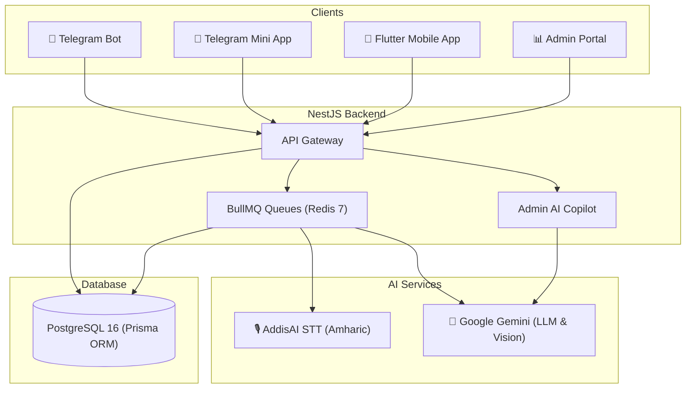

# 🌾 Muday (ሙዳይ)

> **Voice-First Telegram Expense Tracker for Ethiopia — Powered by AddisAI STT & Google Gemini**

[](https://nestjs.com/)
[](https://react.dev/)
[](https://flutter.dev/)
[](https://deepmind.google/technologies/gemini/)
[](https://addisassistant.com/)
[](https://www.postgresql.org/)
[](https://redis.io/)

**Muday** (ሙዳይ) makes tracking personal finances in Ethiopia as effortless as sending a voice note. Instead of manually filling forms, users simply speak in **Amharic or English** on Telegram, send photos of receipts, or auto-sync bank SMS alerts.

---

## ⚡ What Makes Muday Advanced?

### 🎙️ 1. Native Amharic Speech-to-Text (AddisAI)
- **High-Accuracy Amharic STT:** Powered by **AddisAI**, specifically tuned for Ethiopian accents, Ge'ez script, and background noise.
- **Code-Switching Ready:** Easily understands mixed Amharic and English sentences (e.g., *"ለትራንስፖርት 150 birr ከፍያለሁ"*).
- **Audio Pipeline:** Converts voice notes (OGG/Opus) via **FFmpeg** and processes them through asynchronous **BullMQ** background queues.

### 🧠 2. Smart Financial Extraction (Google Gemini)
- **Zero-Shot Ledger Parsing:** Google Gemini extracts the amount (`ETB`), category, direction (`income` / `expense`), platform (`Telebirr`, `CBE`, `Cash`), and notes.
- **Multimodal Receipt OCR:** Snap a picture of a receipt; Gemini extracts the merchant, total, and line items automatically.
- **Interactive Clarifications:** If an amount is unclear, the bot asks a quick one-tap question instead of failing.

### 📱 3. Complete Ecosystem
- **Telegram Bot (Primary):** Voice logging, text fallback, daily morning reminders, nightly summaries, and weekly reviews.
- **Telegram Mini App:** A sleek React 19 dashboard inside Telegram to view balances, category breakdowns, and transaction history.
- **Flutter Mobile App:** Companion app that automatically reads and syncs bank SMS alerts (Telebirr, CBE Birr, Dashen, Awash) with offline outbox support.
- **Executive Admin Portal:** Modern analytics dashboard with a **Gemini AI Copilot** that answers business queries and exports reports to Excel, Word, or CSV.

---

## 🏗️ Architecture



---

## 🛠️ Tech Stack

| Layer | Technologies |
| :--- | :--- |
| **Backend** | NestJS 11, TypeScript, Prisma 7, PostgreSQL 16 |
| **Queues & Cache** | BullMQ, Redis 7, FFmpeg |
| **AI & Voice** | AddisAI (Amharic STT), Google Gemini 3.6 Flash (Extraction & Vision) |
| **Bot Framework** | GrammY (Telegram Bot API) |
| **Mini App & Admin** | React 19, Vite, Tailwind CSS v4, shadcn/ui, Recharts |
| **Mobile App** | Flutter 3.x, BLoC, Hive, Android SMS Telephony |

---

## 🚀 Quickstart

### Prerequisites
- Node.js 24+ & npm 11+
- Docker & Docker Compose
- FFmpeg (for local non-Docker development)

### 1. Setup Environment
```bash
git clone https://github.com/Eyeyuel/muday.git
cd muday
cp .env.example .env
```
Add your credentials in `.env`:
- `TELEGRAM_BOT_TOKEN` (from @BotFather)
- `GEMINI_API_KEY` (from Google AI Studio)
- `ADDISAI_API_KEY` (from AddisAI)

### 2. Run with Docker (Easiest)
```bash
npm run docker:local:build
npm run docker:local:up
```
- **API Health:** <http://localhost:3001/health/ready>
- **Swagger Docs:** <http://localhost:3001/docs>
- **Mini App:** <http://localhost:8080>

### 3. Or Run Locally for Development
```bash
# 1. Start database & Redis
npm run infra:up

# 2. Setup database
npm install
npm run setup:local

# 3. Start API, Worker, and Mini App
npm run dev

# 4. In a second terminal, start the bot:
npm run dev:bot
```

---

## 🧪 Testing & Verification

```bash
# Run all quality checks (lint, format, types, tests, build)
npm run verify

# Run integration tests
npm run ci
```

---

## 🔒 Security & Privacy
- **Zero Audio Storage:** Temporary voice files are stored on isolated in-memory `tmpfs` mounts and deleted immediately after transcription.
- **Pairing Code Security:** Mobile connects via a 6-character code hashed with bcrypt (salt cost 12) + pepper.
- **Complete Data Deletion:** Full user data wipe available on demand via `/deletemydata`.
